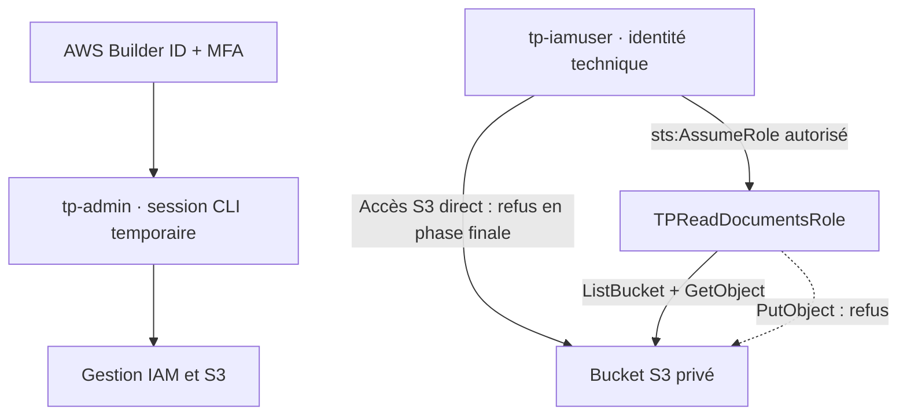

# TP3 — AWS IAM : sécuriser les accès à un bucket S3

**Nova Services · Gestion des identités et des accès (IAM) · TP réalisé et nettoyé**

Ce laboratoire met en pratique le **principe du moindre privilège** sur AWS : une identité technique ne doit pouvoir lire que les documents nécessaires, sans pouvoir écrire dans un bucket S3 privé. Les autorisations ont été testées avec des policies IAM, une bucket policy et une session temporaire obtenue avec **AWS STS / AssumeRole**.

> **État final :** les scénarios IAM/S3/STS principaux ont été vérifiés, le scénario du refus explicite a été confirmé par un retest, et **toutes les ressources AWS créées pour ce TP ont été supprimées**. Le compte AWS et le MFA Builder ID ont été conservés.

## Environnement

| Élément | Configuration du laboratoire |
| --- | --- |
| Offre | AWS Free plan |
| Région | `eu-north-1` |
| AWS CLI | v2.37.9 |
| Connexion humaine | AWS Builder ID, MFA TOTP |
| Profil d'administration CLI | `tp-admin` (session temporaire) |
| Identité technique | `tp-iamuser` (supprimée en fin de TP) |
| Rôle de lecture | `TPReadDocumentsRole` (supprimé en fin de TP) |
| Stockage | Bucket S3 privé, ACL désactivées, Block Public Access actif, SSE-S3/AES256 |

## Scénarios réalisés

1. **Refus implicite :** `tp-iamuser`, initialement sans permission S3, ne peut ni lister ni lire les objets.
2. **Identity-based policy :** `TPReadDocuments` autorise `s3:ListBucket` et `s3:GetObject` sur le bucket du TP ; `PutObject` reste refusé.
3. **Retrait des permissions :** détacher la managed policy rétablit le refus de lecture.
4. **Resource-based policy :** une bucket policy autorise ce même utilisateur à lister et lire, sans rendre le bucket public.
5. **Refus explicite :** `TPDenyRead` refuse `GetObject` même lorsque la bucket policy contient un Allow ; `ListObjects` reste autorisé au **retest concluant**.
6. **AssumeRole :** l'appel à STS est d'abord refusé, puis autorisé uniquement pour le rôle ciblé. Le profil `tp-role` lit les objets, tandis que `tp-user` ne conserve aucun droit de lecture direct.

**Traçabilité :** lors du premier test combinant bucket policy et Deny, `ListObjects` avait également été refusé. Un retest après attente a produit le résultat attendu (`ListObjects = ALLOW`, `GetObject = DENY`). La cause précise de l'écart initial n'a pas pu être démontrée ; elle reste documentée, sans attribution causale certaine.

Pour les résultats détaillés, les cas non exécutés et la matrice des preuves, voir [docs/tests.md](docs/tests.md).

## Architecture logique



Cette architecture décrit **l'état du scénario final avant nettoyage**. Les ressources de laboratoire n'existent plus dans le compte AWS.

## Documentation et preuves

- [Compte rendu complet](compte-rendu.md) — contexte, démarche, résultats et conclusion.
- [Matrice des tests](docs/tests.md) — résultats effectivement observés et diagnostic du Deny.
- [Questions et mini-exercices](docs/questions.md) — réponses pédagogiques.
- [Architecture](docs/architecture.md) — principes IAM, S3 et STS.
- [Rapport de nettoyage](docs/cleanup.md) — ressources supprimées et vérifications.
- [Policies JSON](policies/) — documents de permissions utilisés pendant le TP.
- [Preuves expurgées](captures/evidence/) — éléments conservés sans identifiants secrets.

## Exécution et sécurité

Le projet contient les scripts et les policies du laboratoire pour consultation. **Il n'est pas directement réexécutable sans recréer un projet AWS et les ressources supprimées.**

Les scripts d'environnement prévoient les shells Fish et Bash :

```fish
# Fish — dans un nouvel environnement de laboratoire uniquement
source scripts/use-lab-env.fish
./scripts/check-env.sh
```

```bash
# Bash — dans un nouvel environnement de laboratoire uniquement
source scripts/use-lab-env.sh
./scripts/check-env.sh
```

Les identifiants AWS ont été conservés dans un dossier local `.secrets/` ignoré par Git, puis supprimés après le nettoyage. Aucune access key, secret, session token, information de récupération MFA ou fichier CSV de credentials n'est nécessaire au dépôt.

## Nettoyage final

Le nettoyage a été exécuté et vérifié : access key désactivée puis supprimée, utilisateur `tp-iamuser`, rôle `TPReadDocumentsRole`, policies et bucket S3 du TP supprimés. La session CLI `tp-admin` a été terminée et le dossier local `.secrets/` retiré. Le compte AWS et son MFA sont restés actifs.

**Conclusion :** le TP illustre la séparation entre authentification et autorisation, la priorité d'un Deny explicite, et l'intérêt des rôles STS à privilèges minimaux.
