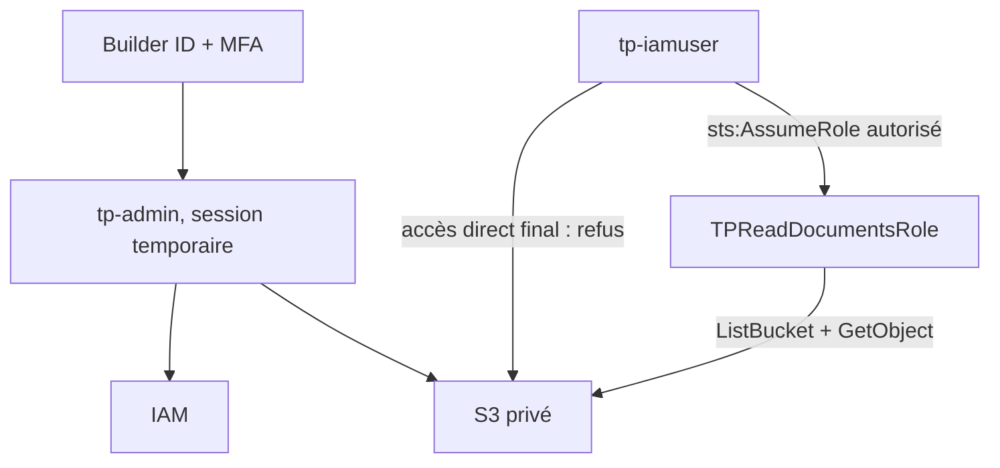

# Architecture du laboratoire

Région : `eu-north-1`. Le bucket utilise Block Public Access, Bucket owner
enforced et SSE-S3 AES256. Son nom et l'identifiant du compte sont conservés
uniquement dans `.secrets/lab.env` et ne sont pas répétés ici.
